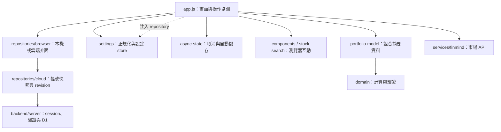

# 開發與 Next.js 遷移指南

本指南供維護者與 AI agent 共用。連線版最新資料契約與部署方式見 [Cloudflare 部署指南](cloudflare-pages.md)。閱讀順序為根目錄 `AGENTS.md` → 本文件 → 目標模組及相關測試。更新日期：2026-11-10。

## 現在的架構

本分支 codex/online-platform 是 Google 登入與 D1 連線版，前端仍是原生 JavaScript，沒有 React／Next.js 執行環境。Pages 發布版先確認 session，再注入雲端 repository；本機 HTML 保留本機模式。使用者開啟 `frontend/index.html`，載入由來源模組產生的 `frontend/app.bundle.js`；資料透過瀏覽器 repository 存在 IndexedDB 或本機儲存。

目錄名稱不是執行環境的保證：`frontend/js/app/settings.js` 可在沒有 DOM 的環境匯入；同目錄的 `stock-search.js` 則包含瀏覽器互動。依實際依賴區分。

| 位置 | 責任 | 未來遷移方式 |
| --- | --- | --- |
| `frontend/js/domain/` | 持股、配息、退休、趨勢、匯入驗證 | 保留計算與測試，視需要補 TypeScript 型別 |
| `frontend/js/app/portfolio-model.js` | 組合持股、價格、股息、資產及預測 | React 頁面或伺服器直接呼叫 |
| `frontend/js/app/settings.js` | 預設設定、相容舊資料、序列化寫入與訂閱 | 每個客戶端 Provider 建立 store，注入資料介面 |
| `frontend/js/app/async-state.js` | 可取消工作與延遲儲存 | 保留控制邏輯，接上 React 的建立與清理生命週期 |
| `frontend/js/repositories/browser.js` | 現有瀏覽器資料存取 | 初期沿用；雲端化時新增有相同契約的介面 |
| `frontend/js/services/finmind.js` | 市場請求、逾時與取消 | 決定留在客戶端或由伺服器代理，保留錯誤語意 |
| `frontend/app.js`、`frontend/js/components/`、`frontend/js/app/stock-search.js` | HTML、DOM、路由與 UI 狀態 | 按功能改寫成 React 元件／hooks |
| `frontend/styles.css` | 目前樣式與設計 token | 先保留視覺結果，再按元件範圍整理 |
| `scripts/build-static.cjs`、`frontend/app.bundle.js` | 支援本機 HTML 的建置 | 正式切換交付方式後交由 Next.js 建置取代 |

## 已建立的核心介面

### 設定

`normaliseSettings(source, { asOfMonth, resetMarketSync })` 負責載入與還原的相容規則；`asOfMonth` 由呼叫端明確提供。載入與還原都使用這個入口，避免兩套規則逐漸不同。

`createSettingsStore({ repository, initialSettings })` 的 repository 只需提供非同步 `save(record)`，因此核心不需要知道資料存在 IndexedDB 還是伺服器。

- `getSnapshot()`：讀取目前設定；未變更時保持同一參照。
- `getRevision()`：讀取資料版本，供載入流程辨識舊快照。
- `subscribe(listener)`：成功更新後通知，回傳解除訂閱函式。
- `save(patch)`：排隊寫入，寫入成功後才更新快照；失敗會拒絕該次 Promise，後續寫入仍可執行。
- `replace(snapshot)`：替換記憶體狀態並通知，不寫入 repository。
- `whenIdle()`：等待已排隊寫入結束；寫入錯誤由各次 `save()` 的呼叫端處理。

快照視為唯讀，不得直接修改 `getSnapshot()` 的屬性。`frontend/app.js` 現階段由訂閱更新讀取參照，畫面不再自行修改設定預設值。

載入流程先等待寫入，記住 revision，再讀 repository；資料返回時只有 revision 仍相同才套用設定。清除／還原另須等待舊寫入與資料遷移後再替換。`replace()` 本身不是取消請求或中止寫入的工具。

未來 React 可以使用此訂閱介面搭配 `useSyncExternalStore`。store 要由對應使用者／Provider 持有，避免在 Next.js 伺服器模組中建立跨請求共享的使用者設定。SSR 初始快照需與首次客戶端渲染一致；本機儲存資料在瀏覽器掛載後讀取。

### 投資摘要

`calculatePortfolioSnapshot({ transactions, marketCaches, dividendDateBasis, asOfDate, requiredThroughDate })` 回傳以下資料：

- 持股與各股票最新價格。
- 資產、成本與股息摘要。
- 年股息預測、涵蓋範圍及殖利率。

它不讀 DOM、不存資料、不發請求。`asOfDate` 是報表日期，`requiredThroughDate` 是市場資料應涵蓋的交易日；兩者可能因週末或休市而不同。未取得報價時保留成本估算，股息歷史不足時保留 coverage 資訊，畫面必須呈現這些限制。

`asOfDate` 控制持股、價格與分割的計算基準，股息報表仍保留已公告的未來發放項目。因此整份摘要不是只含過去資料的歷史損益報表；歷史資產曲線由 `calculateTrendHistory` 產生。

目前 `frontend/app.js` 依交易陣列、快取陣列、日期與股息依據快取摘要。更新資料時必須替換陣列參照，否則快取不會失效。核心輸出為普通資料物件，方便未來作為 API 回應或畫面 props。

## 建議的遷移順序

1. **建立 Next.js 基礎與資料型別。** 新建 layout、頁面路由與型別；沿用 domain、設定與摘要模組。此步才安裝 Next.js／React，現階段不需要框架相依套件。
2. **先遷移設定頁。** 接上 settings store、錯誤／重試與瀏覽器 repository，驗證訂閱及卸載時的儲存處理。
3. **逐頁遷移總覽、交易、預算與試算。** HTML 字串改成 React 元件，事件改成 React handlers，頁面草稿留在元件狀態；計算仍呼叫原核心。
4. **遷移同步及互動生命週期。** 明確定義控制器的建立、取消與清理，涵蓋下列清單。
5. **另一步加入登入與雲端資料。** 實作 API、使用者權限、資料庫及資料遷移，保留備份匯入入口。Next.js 本身不會將本機資料自動上傳或同步。
6. **驗收後移除舊入口與建置。** 保留 domain／store 測試，將 DOM 模擬及字串結構測試逐步換成 React 互動與真實瀏覽器測試。

新專案可採 `src/app/` 放路由，`src/components/` 放 React 元件，`src/domain/` 放計算，`src/application/` 放設定與摘要組合，`src/data/` 放客戶端／伺服器資料介面。這是未來建議布局，目前目錄尚未改成這套結構。

## 尚未完成的生命週期工作

目前 `frontend/app.js` 仍有模組層級 UI 狀態，匯入會讀取 DOM、註冊事件並啟動載入。它不能直接匯入 Server Component，也尚未提供可重複 mount/dispose 的介面。

將現有畫面暫時嵌入 React 前，至少需要完成：

- 對 `visibilitychange`、`online`、`hashchange` 註冊與解除成對處理。
- 卸載立即使舊工作失效，取消同步並等待已開始的寫入；舊 callback 不得重新排程或更新新畫面。
- 處理載入、檔案讀取、儲存與還原確認中的 Promise；一般切頁／卸載應保留已輸入設定，清除／還原才丟棄舊待儲存值。
- 清理拖曳期間的 document pointer listeners、長按數字按鈕 interval、Undo timer 及焦點／圖表 animation frame。
- 對話框、確認視窗、toast 與股票搜尋改成由實例管理，清理 body 狀態、inert、焦點、blur timer 及未完成請求。
- DOM 查詢限制在自己的掛載範圍，避免舊實例操作新頁面同 ID 的元素。

須以重複掛載、未完成請求中卸載、拖曳／長按中卸載等測試驗證。較直接的路線是逐頁重建 React UI，沿用計算與資料模組。

## 客戶端、伺服器與本機資料

互動狀態與 `window`、localStorage、IndexedDB 放在客戶端生命週期。`'use client'` 不代表匯入及首次渲染可以任意讀取瀏覽器物件，Client Components 仍可能被預先渲染。

伺服器可使用純計算與摘要模組，但資料必須來自具備使用者權限的介面。各層交界採普通資料物件與明確的日期字串，是本專案方便備份、測試與 API 交換的約定。

現有資料依瀏覽器與網站來源儲存。從 `file://` 換到網站網址，或更換網域時，應提供 JSON 備份匯出／還原流程，不能假設新來源可以直接讀取舊資料。

Next.js 靜態匯出可繼續使用靜態主機，但應規劃透過網址開啟；目前雙擊 HTML 的交付方式不應被視為自動保留。登入、動態寫入 API 等功能則需相應的服務端設施。

官方參考：[Server／Client Components](https://nextjs.org/docs/app/getting-started/server-and-client-components)、[Static Exports](https://nextjs.org/docs/app/guides/static-exports)、[Project Structure](https://nextjs.org/docs/app/getting-started/project-structure)。採用時核對目標 Next.js 版本。

## 股價同步時間與晚到資料（2026-10-05）

- `MARKET_DATA_READY_MINUTES` 統一控制台北時間 17:30 的當日查詢門檻與自動排程；網頁重新開啟或回到前景也會檢查是否需要同步。
- 價格查詢成功後，必須確認實際最新報價已涵蓋目標交易日，才能標記完成。來源尚未上架或個股無報價時保留舊價格、顯示資料尚未取得，並以 5、10、20、40 分鐘及最多每 60 分鐘重試。預定重試跨午夜或目標已不是當日，就改等下一個平日 17:30 排程，避免停牌個股持續輪詢；不將缺價自動判定為停牌或已完成。API 錯誤仍沿用原有重試。
- `createMarketSyncPlan` 的價格增量起點同時核對 `priceCheckedThrough` 與實際最新報價日期，修復舊快取誤標完成的情況。股息及分割同步狀態仍獨立保存，空股息清單可視為成功。
- `lastMarketDate` 只採計有限且大於 0 的收盤價，讓完成狀態、增量查詢與資產計算使用一致的有效報價標準；零價或無效價格仍可保留在原始快取，但不能讓同步標記完成。只有缺價且其他項目都成功時，才使用跨午夜的延後排程；同時有股息或分割 API 錯誤時，維持原本的退避重試間隔，待 API 恢復後再回到缺價排程。

## Cloudflare Pages 交付

`node scripts/build-pages.cjs` 沿用 `build-static.cjs` 的 `buildBundle()`，在 `dist/` 產生最新腳本並複製 HTML／CSS 與頁面提供下載的公開範例 `my-stock-transactions.csv`，不修改 frontend/app.bundle.js。僅允許發布這四個檔案，避免公開其他個人 CSV、測試與文件；每次建置清空重建 `dist/`。新增圖片等執行時資源時，須同步更新 Pages 發布清單。Git 整合的建置命令與 `dist` 輸出目錄須於控制台設定，不新增影響既有 Workers 的 Wrangler 設定。詳見 [部署指南](cloudflare-pages.md)。

## 驗證方式

在專案根目錄執行 `node scripts/build-static.cjs`、`node --test`、`node scripts/build-static.cjs --check`、`git diff --check`。連線版驗證環境為 Node.js 24.14.1。

- `tests/architecture.test.js`：阻止可重用模組依賴畫面／儲存／網路，檢查無瀏覽器環境匯入。
- `tests/settings-store.test.js`：設定訂閱、寫入排隊、失敗恢復與實例隔離。
- `tests/portfolio-model.test.js`：摘要一致性、估算語意與跨時區日期。
- 其餘測試涵蓋既有計算、同步取消、清除還原、設定競爭、互動及靜態產物。

`tests/support/` 的 VM／模擬 DOM 只用於測試，未被打包。既有部分測試會查看或替換程式字串；後續改寫 React 時應保留它們所保護的行為，逐步改用公開介面驗證。

自動測試通過不能代替實際瀏覽器排版、鍵盤與行動裝置驗收。當工具政策阻擋瀏覽器驗證時，應列出限制，不得宣稱已完成視覺驗收。

## 分割校正與股票比較（2026-09-29）

- `frontend/js/domain/splits.js`：純函式，解析分割事件、計算累積股數倍率與價格換算。所有計算接收日期；分割當天的交易已屬新股數基準，只有事件日前的持股乘倍率。多次事件累乘，總取得成本不變。反分割保留小數等值股數，不自行假設零股售出日或現金結算價。
- `TaiwanStockSplitPrice` 以完整清單同步，涵蓋來源提供的分割、反分割及面額變更。參考價會四捨五入，不能直接用前後價相除：以一分錢誤差容許值、分母 1～10／分子 1～1000 尋找唯一比例。這是推得的比例，不是來源直接提供的法定股數比例；沒有唯一解就標記錯誤，不能猜測。來源未列出的事件亦無法自動補出。
- 市場快取新增 `splits`、`splitCheckedThrough`、`splitError`。成功更新以完整快照取代，處理修訂／取消；失敗保留舊事件並標記不完整。舊快取缺少確認日期時會自動補查。這些欄位是可重建快取，JSON 個人資料備份 schema 維持 3。
- 持股、市值、逐筆與群組損益、資產走勢、股息收取及預估股息都使用相同分割規則。`calculateHoldingGroups(transactions, marketCaches, asOfDate)` 支援日期與事件輸入；舊單參數呼叫仍可用。`calculatePortfolioSnapshot` 的持股和最新價格現以 `asOfDate` 截取，價格再換成該日股數基準；已公告的未來股息仍保留供畫面呈現。
- 配息領取按除息資格日持股計算，不以發放日股數代替。近 12 個月預估股息會把歷史每股配息換算成目前股數基準；配息與分割資料都完整時才顯示完整退休試算。行情表保留未還原 OHLC，分割日加標記，行情漲跌幅改用同基準的前收盤價。
- `frontend/js/domain/comparison.js`：計算 2～5 檔的共同起訖交易日，以分割調整後價格起算 0%。中間缺價為 `null`，不補 0、不畫連接線。支援 `mode: price | cash | stock | total`，分別為純股價、現金再投入、配股、兩者皆含；未傳 mode 時保留 `reinvestDividends`／`reinvest` 的舊布林入口（true 對應 total）。`normaliseComparisonDividends(rows)` 加總盈餘及公積股利，分別保留 `exDate` 與 `stockExDate`。現金於除息日收盤價買入小數股，股票股利於除權日以每 10 元換算 1 股；同日所有股利使用相同資格股數，不讓同日新股再次領息。現金事件缺當日價格、所選股利缺日期或覆蓋不足時停止計算；其他缺價日保留曲線缺口。
- `frontend/js/app/comparison-page.js`：搜尋、多選、日期、股息再投入切換、圖表與浮動 tooltip。依賴透過參數注入；直接沿用 `stockSearch.suggestions()`／`resolve()` 與 FinMind service。提供現金再投入與配股兩個獨立按鈕，均使用 aria-pressed。任一開啟時查詢 `TaiwanStockDividend`（1990-01-01 至 2100-01-01），涵蓋來源已公告的完整資料，避免 API 的權利分派基準日篩選漏掉圖表期末除息；覆蓋僅確認至傳入的市場日期，不宣稱未來資料完整。比較股利只沿用本頁工作階段的完整格式，不沿用持股頁舊快取。切換選項先取消舊工作，等待結束後以固定 mode 重新計算；revision 防止清除／日期修改後復活。成功快照在工作階段內重用，清除或重新開啟會重新取得公告修訂。清除／還原時由 `replaceDataSafely()` 取消比較請求並清空工作階段快取，避免舊回應復活。
- 股票比較使用 `#stock-comparison`，側欄位於「額外工具」。圖表同時提供鍵盤、觸控、文字摘要和每日資料表。切換日期／標的會清除舊結果並取消請求；分割或股息查詢失敗會阻止產生誤導曲線。
- 原本已把分割股數人工當作「配股」記入的資料不會自動刪除或猜測修正；畫面明確提醒核對，避免重複加股。

新增回歸在 `tests/splits-comparison.test.js` 與 `tests/sync-lifecycle-regression.test.js`，涵蓋分割同日買進、多次分割／反分割、舊價格換算、股息基準、浮動 tooltip、缺價、失敗重試與同步取消。根目錄三份過時測試入口改為轉用 `tests/` 的維護版本，避免繼續測試舊版拼接方式。

比較日期是查詢範圍，不受交易日曆最新日期的 `max` 限制。結束日可晚於最新行情，使用範圍內共同可用的起訖交易日並顯示實際區間；分割涵蓋檢查也以實際終日為準。查詢未來／尚無行情日期時，不把尚未涵蓋的日期寫成已完成快取，下次仍能查得新價格。

## 共用持股走勢（2026-11-10）

- `frontend/js/components/asset-trend-chart.js` 的 `createAssetTrendChart` 為瀏覽器 UI 元件；首頁、整檔持股及單筆交易共用繪圖與操作。透過 getter 注入交易、行情、設定、台北日期與掛載容器；不同實例各自保留頻率、期間及明細狀態。彈出視窗使用獨立的 ID 前綴。
- `render()` 產生圖表 HTML，插入容器後呼叫 `bind()`；`repaint()` 更新目前容器，`dispose()` 移除事件監聽並取消動畫與拖曳。容器被替換或視窗關閉前必須呼叫 `dispose()`。這只是圖表生命週期，不代表整個 `frontend/app.js` 已完成 mount/dispose。
- `calculateTrendHistory` 每筆資料新增 `cost`，表示該日累積取得成本（含手續費與再投入）；分割不改變成本。首頁保留原本外部投入成果口徑，持股／單筆使用取得成本計算帳面報酬並繪製成本線。
- 單筆僅納入選定交易，不推定後續再投入或配股的歸屬。整檔納入該股票全部交易；兩者的帳面損益皆不加計現金股息，零成本交易不顯示無限大的報酬率。缺價沿用成本估算，已知分割套用原有校正規則。備份格式不變。

## 連線版分支與責任（2026-11-10）

開發與部署分支為 `codex/online-platform`；`main` 保留既有版本。原本根目錄前端全部移入 `frontend/`，建置產物為 `frontend/app.bundle.js`；測試與建置指令仍由根目錄執行。上述 Next.js 遷移計畫屬未來工作，連線版不以遷移框架為前置條件。

`frontend/js/repositories/cloud.js` 管理單頁的帳號快照、寫入排隊及伺服器 revision；`browser.js` 保留既有方法，登入後把個人資料轉交 cloud store，市場快取維持本機。`frontend/js/app/cloud-session.js` 管理 HTTP、雲端模式判斷及 Google script 載入。`frontend/app.js` 協調登入畫面、啟動與登出，切換帳號透過重新載入清除整個舊生命週期。API 失敗不改用本機儲存。

`backend/server/api.mjs` 管理 HTTP、Origin／session／帳號驗證及 D1；`google-auth.mjs` 使用 Web Crypto 驗證 Google ID token。後端只匯入 frontend 內不依賴瀏覽器的既有 domain 驗證及常數，不匯入 app.js 或 UI。若未來獨立發布前後端，可再把這些純核心移到 shared，目前避免複製規則。D1 個人資料為 512 KiB 內的 versioned JSON 快照，單次 SQL compare-and-swap 確保清除／還原原子性；目前不是逐筆 SQL 表，也不提供離線合併。

`tests/cloud-platform.test.js` 以記憶體 SQLite 執行實際遷移 SQL 與 API 使用的查詢，透過 D1 介面轉接測試帳號隔離、版本衝突、原子替換、session 撤銷與過期；Google 簽章使用本機 RSA 金鑰實際簽署及驗證。這些仍不等同遠端 D1 或真實 Google 瀏覽器驗收。

### 帳號選單與登出

`frontend/js/components/account-menu.js` 只處理 disclosure 的開關、外部點擊、Tab 離開與 Escape 焦點返回；每次重新渲染前解除舊 document 監聽。選單使用原生按鈕與連結，不使用需要方向鍵模型的 ARIA menu。完整帳號資訊放在展開面板與設定頁，手機入口只保留頭像。

`createCloudDataStore({ request, onWriteState })` 的選用通知提供 `saving`／`saved`／`error` 與錯誤物件，必須等所有排隊寫入結束才回報成功；通知本身不得改變儲存成敗。`createAutosave().hasPending` 表示待排程或執行中的設定寫入，供登出等待提示使用。這些狀態只代表本頁送出的儲存工作，不宣稱所有裝置即時同步；尚未提交的交易／生活費表單另顯示「表單尚未送出」。

登出先比較交易／生活費表單的初始欄位與目前值，有修改才確認「返回編輯／捨棄並登出」。確認前不取消或清空草稿；確認後阻止新操作、取消同步、等待載入及寫入、flush 設定，全部成功才撤銷 session。儲存失敗保持登入並恢復操作。401 提供另開分頁重新登入的入口，保留原頁輸入，不自動重新整理。既有本機 HTML 不顯示帳號選單。
